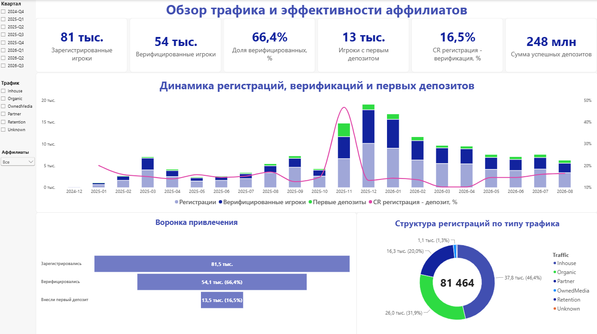
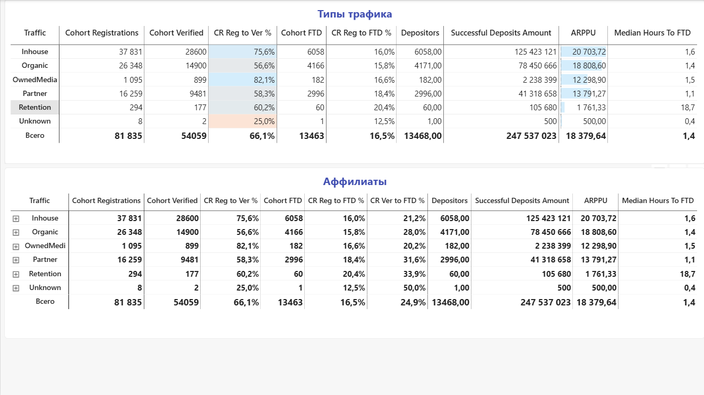
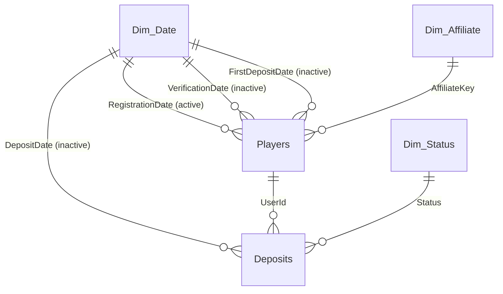

# Player Acquisition Analytics: Traffic and Affiliate Performance

A Power BI dashboard and analytical report on the player acquisition funnel: **registration → verification → first deposit (FTD)**, broken down by traffic type and affiliate. Completed as a take-home assignment for a Data Analyst position.



## Task

Using exports from four sources (player status log, deposit history, player-to-affiliate mapping, traffic type dictionary), the goal was to:

- build a data model and a dashboard with key funnel metrics;
- compare the performance of traffic types and individual affiliates;
- identify data quality issues;
- deliver business conclusions and recommendations.

## Key Results

| Metric | Value |
|---|--:|
| Registered players | 81,835 |
| CR registration → verification | 66.1% |
| CR registration → first deposit | 16.5% |
| CR verification → first deposit | 24.9% |
| Successful deposits amount | 247.5M |
| Median time to FTD | 1.4 h |

**Main findings** (full details in the [analytical report](docs/analytical-note.md)):

1. **Concentration risk.** A single affiliate drives 28% of registrations and 44% of the deposit amount.
2. **The funnel bottleneck is the first deposit, not verification.** 65% of depositors pay within the first 24 hours, so welcome communication has to fire immediately.
3. **Volume and quality come from different sources.** The largest affiliates convert below average, while mid-sized ones convert 2–3× better.
4. **Organic traffic verifies worse but pays better once verified.** Simplifying verification for organic users has the highest upside.
5. **10 data quality issues found**: incomplete affiliate dictionary, left-truncated deposit history, an anomalous spike in November 2025, and more.

## Dashboard

**Page 1. Overview.** KPI cards, monthly registrations / verifications / FTDs with a conversion line, funnel, and registration mix by traffic type. Slicers: quarter, traffic type, affiliate.

**Page 2. Details.** Tables by traffic type and by affiliate (drill-down) with conversion rates, ARPPU and median hours to FTD.



> The dashboard UI labels are in Russian, as required by the original assignment.

## Data Model

Star schema with two fact tables and three dimensions. All transformations are done in Power Query.



| Table | Grain | Source |
|---|---|---|
| `Players` | 1 row = 1 player | status log + first successful deposit + affiliate |
| `Deposits` | 1 row = 1 transaction | deposit history, deduplicated, with a success flag |
| `Dim_Affiliate` | 1 row = 1 affiliate | player mapping + dictionary; `Organic` and `Unknown` defined explicitly |
| `Dim_Date` | 1 row = 1 day | generated from the data range, marked as a Date table |
| `Dim_Status` | 1 row = 1 status | transaction statuses |

**Key design decision: three relationships between `Players` and the calendar.** Only the registration-date relationship is active. The verification-date and first-deposit-date relationships are inactive and are enabled inside measures via `USERELATIONSHIP`. This lets one dashboard support two kinds of metrics:

- **event-based**: how many registrations, verifications and FTDs happened in a period;
- **cohort-based**: what share of players registered in a period went on to verify or deposit, regardless of when that happened.

Traffic type is not duplicated in `Deposits`: it flows transitively through `Players → Dim_Affiliate`, so an affiliate filter works the same way for conversions and for deposit amounts.

More details: [docs/data-model.md](docs/data-model.md).

## DAX Examples

```dax
-- Event-based metric: verifications by the verification date itself
Verified Players =
CALCULATE (
    COUNTROWS ( Players ),
    Players[IsVerified] = 1,
    USERELATIONSHIP ( Dim_Date[Date], Players[VerificationDate] )
)

-- Cohort conversion: players are pinned to their registration month
CR Reg to FTD % = DIVIDE ( [Cohort FTD], [Cohort Registrations] )

-- Share of players who made their first deposit within 24 hours
FTD within 24h % =
DIVIDE (
    CALCULATE ( COUNTROWS ( Players ), Players[IsDepositor] = 1, Players[HoursToFTD] <= 24 ),
    [Cohort FTD]
)
```

All 24 measures: [src/dax/measures.dax](src/dax/measures.dax). All Power Query queries: [src/power-query/](src/power-query/).

## Tech Stack

Power BI Desktop · Power Query (M) · DAX · star schema modeling · cohort analysis

## Repository Structure

```
├── dashboard/
│   └── affiliate-traffic-dashboard.pbix   # Power BI report
├── docs/
│   ├── analytical-note.md                 # analytical report: findings and data quality
│   └── data-model.md                      # data model description
├── images/                                # dashboard screenshots
└── src/
    ├── dax/measures.dax                   # all DAX measures
    └── power-query/                       # all M queries in dependency order
```

## How to Open

1. Download `dashboard/affiliate-traffic-dashboard.pbix` and open it in [Power BI Desktop](https://www.microsoft.com/power-platform/products/power-bi/desktop) (free, Windows).
2. The data is already loaded into the file, so no refresh is needed. To refresh from CSV, point the `FolderPath` parameter to the folder with the source files (*Transform data → Edit parameters*).

## Author

**Denis Marfin** — Data Analyst (BI, SQL, Python)
