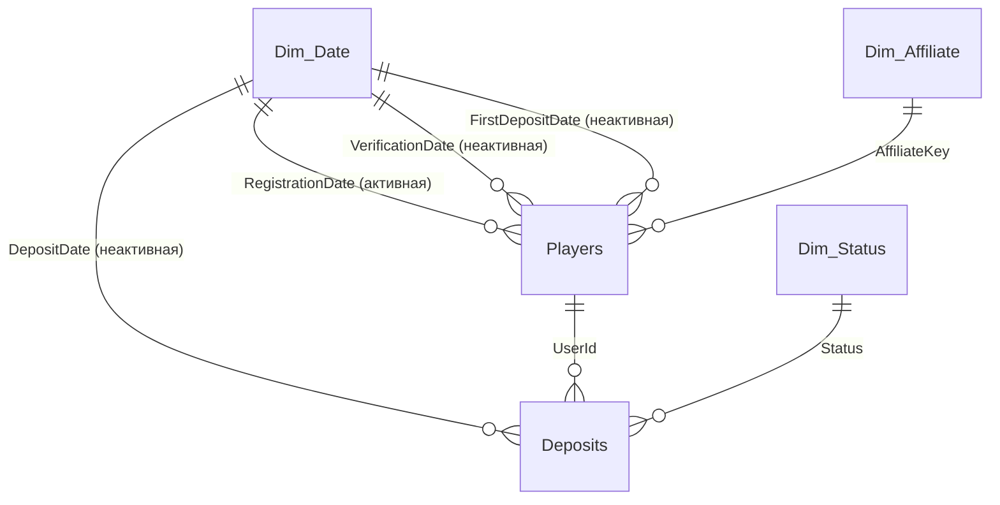

# Аналитика привлечения игроков: трафик и эффективность аффилиатов

Дашборд в Power BI и аналитическая записка по воронке привлечения: **регистрация → верификация → первый депозит (FTD)** в разрезе типов трафика и аффилиатов. Выполнено как тестовое задание на позицию аналитика данных.


## Задача

По выгрузкам из четырёх источников (лог статусов игроков, история депозитов, привязка игроков к аффилиатам, справочник типов трафика) нужно было:

- построить модель данных и дашборд с ключевыми метриками воронки;
- сравнить эффективность типов трафика и отдельных аффилиатов;
- найти проблемы качества данных;
- сформулировать выводы и рекомендации для бизнеса.

## Ключевые результаты

| Метрика | Значение |
|---|--:|
| Зарегистрированные игроки | 81 835 |
| CR регистрация → верификация | 66,1 % |
| CR регистрация → первый депозит | 16,5 % |
| CR верификация → первый депозит | 24,9 % |
| Сумма успешных депозитов | 247,5 млн |
| Медианное время до FTD | 1,4 ч |

**Главные выводы** (подробно в [аналитической записке](docs/analytical-note.md)):

1. **Концентрационный риск.** Один аффилиат приносит 28 % регистраций и 44 % суммы депозитов.
2. **Узкое место воронки — первый депозит, а не верификация.** 65 % депозиторов платят в первые 24 часа, поэтому welcome-коммуникация должна срабатывать сразу.
3. **Объём и качество дают разные источники.** Крупнейшие аффилиаты конвертируют хуже среднего, а средние по объёму — в 2–3 раза лучше.
4. **Органика хуже верифицируется, но лучше платит после верификации.** Упрощение верификации для органики даёт наибольший потенциальный прирост.
5. **Найдено 10 проблем качества данных**: неполный справочник аффилиатов, обрезанная история депозитов, аномальный всплеск в ноябре 2025 и другие.

## Дашборд

**Страница 1. Обзор.** KPI-карточки, динамика регистраций, верификаций и FTD с линией конверсии, воронка, структура по типу трафика. Срезы: квартал, тип трафика, аффилиат.

**Страница 2. Детализация.** Таблицы по типам трафика и аффилиатам (drill-down) с конверсиями, ARPPU и медианным временем до FTD.


## Модель данных

Схема «звезда»: две таблицы фактов и три измерения. Все преобразования сделаны в Power Query.



| Таблица | Гранулярность | Источник |
|---|---|---|
| `Players` | 1 строка = 1 игрок | лог статусов + первый успешный депозит + аффилиат |
| `Deposits` | 1 строка = 1 транзакция | история депозитов, дедупликация, флаг успешности |
| `Dim_Affiliate` | 1 строка = 1 аффилиат | привязка игроков + справочник; `Organic` и `Unknown` заданы явно |
| `Dim_Date` | 1 строка = 1 день | генерируется по диапазону данных, помечена как Date table |
| `Dim_Status` | 1 строка = 1 статус | статусы транзакций |

**Ключевое решение: три связи `Players` с календарём.** Активна только связь по дате регистрации. Связи по датам верификации и первого депозита неактивны и включаются в мерах через `USERELATIONSHIP`. Так на одном дашборде работают два типа метрик:

- **событийные**: сколько регистраций, верификаций и FTD произошло в периоде;
- **когортные**: какая доля игроков, зарегистрированных в периоде, дошла до верификации или депозита, независимо от того, когда это случилось.

Тип трафика не дублируется в `Deposits`: он приходит транзитивно через `Players → Dim_Affiliate`, поэтому фильтр по аффилиату одинаково работает и для конверсий, и для сумм.

Подробнее: [docs/data-model.md](docs/data-model.md).

## Примеры DAX

```dax
-- Событийная метрика: верификации по дате самой верификации
Verified Players =
CALCULATE (
    COUNTROWS ( Players ),
    Players[IsVerified] = 1,
    USERELATIONSHIP ( Dim_Date[Date], Players[VerificationDate] )
)

-- Когортная конверсия: игроки закреплены за месяцем регистрации
CR Reg to FTD % = DIVIDE ( [Cohort FTD], [Cohort Registrations] )

-- Доля игроков, сделавших первый депозит в первые сутки
FTD within 24h % =
DIVIDE (
    CALCULATE ( COUNTROWS ( Players ), Players[IsDepositor] = 1, Players[HoursToFTD] <= 24 ),
    [Cohort FTD]
)
```

Все 24 меры: [src/dax/measures.dax](src/dax/measures.dax). Все запросы Power Query: [src/power-query/](src/power-query/).

## Стек

Power BI Desktop · Power Query (M) · DAX · моделирование «звезда» · когортный анализ

## Структура репозитория

```
├── dashboard/
│   └── affiliate-traffic-dashboard.pbix   # отчёт Power BI
├── docs/
│   ├── analytical-note.md                 # аналитическая записка: выводы и качество данных
│   ├── data-model.md                      # описание модели данных
│   └── source-docs/                       # исходные .docx и .pptx
├── images/                                # скриншоты дашборда
└── src/
    ├── dax/measures.dax                   # все DAX-меры
    └── power-query/                       # все M-запросы в порядке зависимостей
```

## Как открыть

1. Скачайте `dashboard/affiliate-traffic-dashboard.pbix` и откройте в [Power BI Desktop](https://www.microsoft.com/power-platform/products/power-bi/desktop) (бесплатно, Windows).
2. Данные уже загружены в файл, поэтому обновлять их не нужно. Для обновления из CSV укажите папку с файлами в параметре `FolderPath` (*Преобразовать данные → Изменить параметры*).

## Автор

**Денис Марфин** — аналитик данных (BI, SQL, Python)
